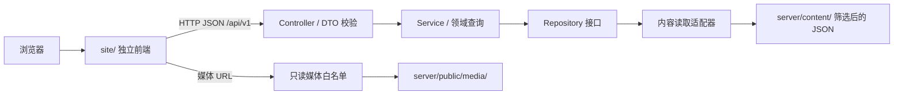

# 个人博客整体架构

状态：按 2026-10-26 确认的 Phase 1 契约完成本地实现；当前变更留在工作区。逐文件调试说明在根目录 `ARCHITECTURE.md`。

## 1. 系统边界

前端 `site/` 使用 HTML、CSS、strict TypeScript；后端 `server/` 使用 Node.js 和 strict TypeScript。两端不导入彼此的源码、不读取彼此的文件，仅通过 HTTP/JSON 协议连接。两端各自维护实体校验器，通过真实 HTTP 契约测试检查一致性。

Controller 负责路由、格式和参数；Service 负责分类、排序、查询与组合；Repository/ContentSource 负责 I/O。各板块 module 及 app.module 负责依赖注入，Service 不创建文件驱动或 HTTP 客户端。

## 2. 模块组织

| 路径 | 职责 |
| --- | --- |
| `site/index/` | 首页 |
| `site/projects/` | 项目列表与详情 |
| `site/notes/` | 笔记列表与详情 |
| `site/life/` | 校园相册 |
| `site/about/` | 个人介绍 |
| `site/not-found/` | 404 |
| `site/self-test/` | 手动接口自测，不进入主导航 |
| `site/assets/css/common/` | 共享样式 |
| `site/assets/css/<section>/` | 板块专用或预留样式 |
| `site/assets/js/` | 共享配置、类型、协议适配与界面行为 |
| `server/src/api/profile/` | 个人资料五件套 |
| `server/src/api/projects/` | 项目五件套 |
| `server/src/api/notes/` | 笔记五件套 |
| `server/src/api/life/` | 生活五件套 |
| `server/src/api/search/` | 搜索五件套 |
| `server/src/api/health/` | 健康检查五件套 |
| `server/src/api/media/` | 媒体五件套 |
| `server/src/common/` | 共享协议、错误、日志与底层读取 |
| `server/src/config/` | 后端配置 |
| `server/content/` | 人工筛选后的可提交内容 |
| `server/public/media/` | 优化后的图片 |

根目录旧静态草稿已被正式模块替代。没有浏览器读取桌面、跨项目运行数据导入或运行时自动扫描。

## 3. HTTP 协议

详细字段、抽象接口与错误码见 [blog-api.md](../contracts/blog-api.md)。

| 用户触发 | 端点 | 成功 data |
| --- | --- | --- |
| 首页、关于页加载 | `GET /api/v1/profile` | ProfileDto |
| 项目列表、分类按钮 | `GET /api/v1/projects?category=...` | ListDto<ProjectSummaryDto> |
| 点击项目 | `GET /api/v1/projects/{slug}` | ProjectDetailDto |
| 笔记列表、分类按钮 | `GET /api/v1/notes?category=...` | ListDto<NoteSummaryDto> |
| 点击笔记 | `GET /api/v1/notes/{slug}` | NoteDetailDto |
| 相册加载、分类按钮 | `GET /api/v1/life?category=...` | LifeDto |
| 输入搜索词 | `GET /api/v1/search?q=...` | ListDto<SearchResultDto> |
| 接口自测 | `GET /api/v1/health` | HealthDto |
| RSS 订阅 | `GET /feed.xml` | RSS XML |
| 显示或放大照片 | `GET /media/{filename}` | image/webp |

成功 JSON 统一 `{data:...}`；失败统一 `{error:{code,message,traceId}}`。POST 等非只读方法返回 405，不存在写接口。列表无匹配返回 200 空列表，读取失败返回 503；二者不混同。

本地 API 使用 `http://127.0.0.1:3000/api/v1`，前端默认为 `http://localhost:4173`。显式 IPv4 防止本机另一个 IPv6 服务截获请求。预览脚本把配置端口注入前端；生产默认同源 `/api/v1`。媒体/RSS 与 API 同源。

## 4. 读写影响

| 请求 | 文件读取 | 文件写入 |
| --- | --- | --- |
| profile | `server/content/profile.json` | 无 |
| projects 列表/详情 | `server/content/projects.json` | 无 |
| notes 列表/详情、feed.xml | `server/content/notes.json` | 无 |
| life | `server/content/life.json` | 无 |
| search | `server/content/profile.json`、`projects.json`、`notes.json`、`life.json` | 无 |
| health | 上述四个内容文件 | 无 |
| media | `server/content/life.json` 与白名单内图片 | 无 |

请求不会创建文件或目录。日志由统一 logger 写到进程输出，宿主自行收集。JSON 每次请求重新读取并完整校验，失败不使用假空数组兜底。重复项目/文章标识被拒绝；媒体验证文件名、白名单与 realpath 边界。

## 5. 页面行为

- 视觉遵守 `UI-SPEC.md`：1220px 三列网格、242px 侧栏、48px 顶栏、靛蓝链接与 15px 正文；大屏按根字号缩放。
- 页面只挂载本板块的脚本；公共导航、主题、目录和搜索由共享装配入口连接。
- 内容块按类型生成有限元素，所有文本转义；后端不发送可执行 HTML。
- 加载失败显示重试面板；筛选失败保留上次内容，重试后才替换。
- 搜索空输入不请求；校验长度；防抖、取消和序号共同避免旧响应覆盖。Ctrl/⌘+K 打开，方向键选择，Enter 打开，Esc 关闭。
- 移动端导航/目录抽屉提供遮罩、焦点循环和关闭后焦点恢复；深色模式在允许时保存到 localStorage。
- 相册限制在当前筛选结果中切换，左右键翻页，Esc 关闭；图片加载失败显示安全提示。

## 6. 配置与日志

两端配置合法值见 README 和根目录逐文件文档。服务日志含事件、级别、traceId、耗时及安全资源标识；异常堆栈移除本机路径，响应不包含路径/原异常。浏览器错误经统一 logger 记录；界面展示固定安全文案。

## 7. 内容来源与取舍

个人介绍整理自个人记录和学习计划；项目介绍整理自实际项目 README 与源码；笔记板块当前为空，内容由本人后续添加。照片使用原记录日期。CANN 官方学习仓库作为学习背景，不列为个人原创作品；已安装应用不列为个人项目；算子练习不列为项目。

未复制身份证、签名、学号、账号、密码、API Key、报销材料、第三方教材及其他项目源码。服务不访问原始桌面文件。

## 8. 验证与交付约束

类型检查、API/业务/契约测试、浏览器 E2E、自测页面和站内链接检查覆盖正常、空态、失败、超时与取消分支。测试详情见 `tests/`，截图与临时文件位于忽略的 `.qa/`。

当前程序通过本地双进程预览交付；自有服务器路由示例在 `nginx.example.conf`。Nginx 示例未在本机验证，公网托管尚未部署。先前登记的私有 Sites ID 保留，未上传本轮源码，也不声明已完成该平台的 Worker 适配。

按 `agent.md` Rule 6，上一轮草稿已形成恢复点，本轮实现不立即 commit/push。规则文件与本机数据始终不入库。
