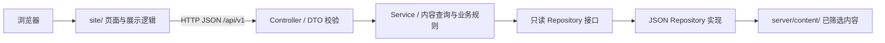

# 个人博客整体架构

状态：Phase 1 架构与契约设计，等待确认后进入实现。

依据：项目根目录 `agent.md`、`UI-SPEC.md`，以及用户补充的“内部语言任意，只要前后端文件分离，仅靠协议相连”。

## 1. 目标与范围

构建李义鑫的个人博客，保留学术主页风格。首期提供个人介绍、项目列表与详情、笔记列表与详情、校园相册、时间归档、全文搜索、主题切换和移动端导航。

- 项目：水木科协网站、日志清单、xiumi-agent、MOD Forge、Valorant 资料站、RotaryPosEmb 算子。
- 学习：操作系统源码阅读、CANN 学习、课程与学习日记。
- 生活：已筛选的训练与班赛照片、校园活动文字记录。
- 首期公开接口全部只读，内容由本地筛选后的结构化文件维护。没有内容编辑后台、账户系统或评论系统的现成需求，不预建这些模块。
- 桌面是本次整理资料的来源。运行中的服务不扫描桌面，也不访问其他项目的运行数据。

## 2. 已有草稿诊断与调整

| 当前文件 | 问题 | Phase 2 处理 |
| --- | --- | --- |
| `scripts/build.mjs` | 同时定义页面模板、组装内容、生成索引和写入磁盘；缺少明确类型、项目日志与错误边界 | 拆除业务生成逻辑。前端负责展示，后端负责内容读取、查询与输出；构建脚本只编译和复制明确的部署资源 |
| `content/site.mjs` | 项目内容与 HTML 片段混合，浏览器展示与内容结构耦合 | 将确认的文字迁移为后端内容 JSON；按 DTO 使用文本块、列表块、代码块等结构，不把页面模板保存在内容文件中 |
| `scripts/serve.mjs` | 临时预览服务没有统一配置和项目日志 | 替换为独立的前端静态预览工具；业务 API 从后端启动，不能把预览服务变成业务服务 |
| `site/assets/theme.js` | 缺少类型和错误记录；资源层次不符合约定 | 改为共享 TypeScript 主题服务，显式处理存储不可用分支 |

不改动 `UI-SPEC.md` 和用户的 `agent.md`。旧实现被替代后清除旧入口与引用，不保留死代码或备份副本。

## 3. 分离边界与数据流

前端采用 HTML / CSS / strict TypeScript；后端采用 Node.js / strict TypeScript。语言不是接口的一部分，后端以后可以换成其他语言，只需遵守 HTTP 契约。



- `site/` 不导入、不读取 `server/` 或根目录内容源；后端不读取前端页面、CSS、脚本或 DOM。
- `contracts/` 只保存线上的协议定义，不充当两端共享的运行时源码。两端各自持有强类型 DTO，并用契约检查保证一致。
- 前端 HTTP 适配器返回经过结构验证的 DTO。页面服务仅依赖适配器接口，通过装配入口注入。
- 后端 Controller 只做路由与参数校验；Service 通过注入的接口读取内容；Repository 承担文件读取与格式解析。
- 搜索、归档需要跨板块内容时，依赖只读服务接口，由装配入口连接，不导入其他板块的具体仓储实现。
- 相册通过后端 DTO 提供的媒体 URL 加载优化后的图片；媒体不暴露原文件路径或 EXIF。

## 4. 目录方案

以下是确认后的目标结构。Phase 1 不预创建业务实现目录。

```text
myself-blog/
├── UI-SPEC.md
├── agent.md                      用户规则，始终不入库
├── README.md                     启动、检查、目录与部署说明
├── ARCHITECTURE.md               实现后的逐文件行为与分支说明
├── docs/
│   └── ARCHITECTURE.md            整体架构与接口登记（本文件）
├── contracts/
│   └── blog-api.md               DTO、HTTP 与 Repository 契约
├── site/                         独立的前端部署单元
│   ├── index/index.html
│   ├── index/assets/index.ts
│   ├── projects/index.html
│   ├── projects/detail.html
│   ├── projects/assets/projects.ts
│   ├── notes/index.html
│   ├── notes/detail.html
│   ├── notes/assets/notes.ts
│   ├── life/index.html
│   ├── life/assets/life.ts
│   ├── archive/index.html
│   ├── archive/assets/archive.ts
│   ├── about/index.html
│   ├── about/assets/about.ts
│   ├── not-found/index.html
│   ├── assets/
│   │   ├── css/common/           共享样式
│   │   ├── css/<section>/        板块专用样式，含预留空样式表
│   │   ├── js/config/            前端唯一配置
│   │   ├── js/types/             HTTP DTO 与展示接口
│   │   ├── js/infrastructure/    HTTP、响应校验、日志、错误
│   │   ├── js/services/          导航、主题、目录、搜索等共享行为
│   │   ├── js/main.ts            共享装配入口
│   │   └── img/                 共享标识与图标
│   └── tsconfig.json
├── server/
│   ├── package.json
│   ├── tsconfig.json
│   ├── content/                  已筛选、可维护的内容 JSON
│   ├── public/media/             优化后的相册图片
│   └── src/
│       ├── main.ts               后端启动
│       ├── app.module.ts         配置和依赖装配
│       ├── config/               环境配置及合法值校验
│       ├── common/               统一错误、日志、HTTP 与内容块契约
│       └── api/
│           ├── profile/
│           ├── projects/
│           ├── notes/
│           ├── life/
│           ├── archive/
│           ├── search/
│           └── health/
│               # 每个板块：controller / dto / service / repository / module
├── scripts/                      构建与本地预览，禁止混入业务内容
├── tests/                        API、契约、浏览器、链接检查
└── hooks/pre-push                全量类型检查门禁
```

每个页面只挂载自己的专用脚本。跨页共用的行为才能进入共享资源区。前后端分别有启动命令与构建命令。

## 5. 协议与页面登记

详细实体、字段和抽象接口见 [blog-api.md](../contracts/blog-api.md)。

| 用户触发 | HTTP 接口 | 页面行为 |
| --- | --- | --- |
| 打开首页或关于页 | `GET /api/v1/profile` | 显示个人介绍、学习方向、外部主页与当前关注事项 |
| 打开项目页或切换分类 | `GET /api/v1/projects?category=...` | 返回项目摘要；空结果显示空态 |
| 打开项目详情 | `GET /api/v1/projects/{slug}` | 显示项目内容块和当前验证状态 |
| 打开笔记页或切换分类 | `GET /api/v1/notes?category=...` | 返回按日期倒序的文章摘要 |
| 打开笔记详情 | `GET /api/v1/notes/{slug}` | 显示正文、日期、阅读时长和目录 |
| 打开生活页或切换类别 | `GET /api/v1/life?category=...` | 显示相册、日期和校园活动文字 |
| 打开归档页 | `GET /api/v1/archive` | 显示文章与生活记录的月份分组 |
| 输入搜索关键词 | `GET /api/v1/search?q=...` | 显示命中片段和页面链接；无输入时不发请求 |
| 执行服务可用性检查 | `GET /api/v1/health` | 返回可用状态，不披露文件路径或环境细节 |
| 读取 RSS | `GET /feed.xml` | 返回笔记 RSS；由后端查询笔记内容并序列化 |
| 加载相册图片 | `GET /media/{filename}` | 返回白名单中的已优化图片，无目录浏览 |

两端通过 HTTP 协议联调。前端本地默认 `http://localhost:4173`，通过统一配置连接 `http://localhost:3000/api/v1`；生产使用同源 `/api/v1`，网关分别路由静态页面与 API。媒体和 RSS 的 origin 由配置确定。

## 6. 错误与可见状态

- 参数无效返回 400；合法标识不存在返回 404；内容源无法读取或校验失败返回 503；未预期错误返回 500。
- 错误固定结构为 `error.code / error.message / error.traceId`。前端只渲染预设安全消息，后台日志关联 traceId 与堆栈。
- 超时、网络断开、响应形状不符时，页面保留当前内容，显示错误与重试入口；不静默空白、不伪造成功、不跳转到登录页。
- 搜索取消旧请求，不把已取消的搜索当成失败；迟到响应不得覆盖新结果。所有数值和网络地址来自统一配置。
- localStorage 不可用时，主题仍可在当前页面切换，并记录 WARNING；不吞异常。
- 后端日志使用统一 logger，包含级别、事件、traceId 和耗时，不记录桌面内容、搜索原文、密钥或身份证明信息。

## 7. 内容和文件影响

部署只包含筛选后的内容、优化照片、前端静态资源与后端程序。身份证照片、签名、学号、报销材料、账单、API Key、密码文件、账号目录、其他项目源码与第三方书籍均不复制。

所有内容接口只读取明确配置的 `server/content/` 文件；图片服务只读取 `server/public/media/`。首期没有数据写接口。运行日志走标准输出的项目 logger，由宿主接管；请求不写回内容目录，不创建用户数据目录。

## 8. 检查与交付

1. 前后端分别执行 strict 类型检查，校验无越界源码导入。
2. HTTP 检查正常列表、详情、空分类、非法参数、缺失内容、搜索上限与媒体路径。
3. 单元测试业务分类、排序、搜索与归档，以及仓储校验错误和响应错误映射。
4. 浏览器检查三栏布局、手机抽屉、主题记忆、搜索键盘操作、目录定位、筛选与相册。
5. 检查站内链接、图片、404、RSS；自测页面调用同一协议。
6. 补齐根目录逐文件 `ARCHITECTURE.md`，记录真实入口、全部错误分支与页面提示；同步 README。

按 `agent.md` Rule 6，本轮实现完成后保留工作区改动供审阅，不立即 commit/push，`agent.md` 始终不入库。当前托管平台只登记了未发布的私有站点，没有上传项目源码或桌面资料。发布需在遵守提交时机规则、完成本地检查后进行。

## 9. Phase 2 入口

确认本方案后：先落实 DTO 与抽象接口，迁移已筛选内容，再实现各板块的 Controller / Service / Repository 与前端 API 适配器，最后完成 UI、联调和验证。已有文字草稿作为内容参考，不能继续以跨目录直接导入方式连接前后端。
